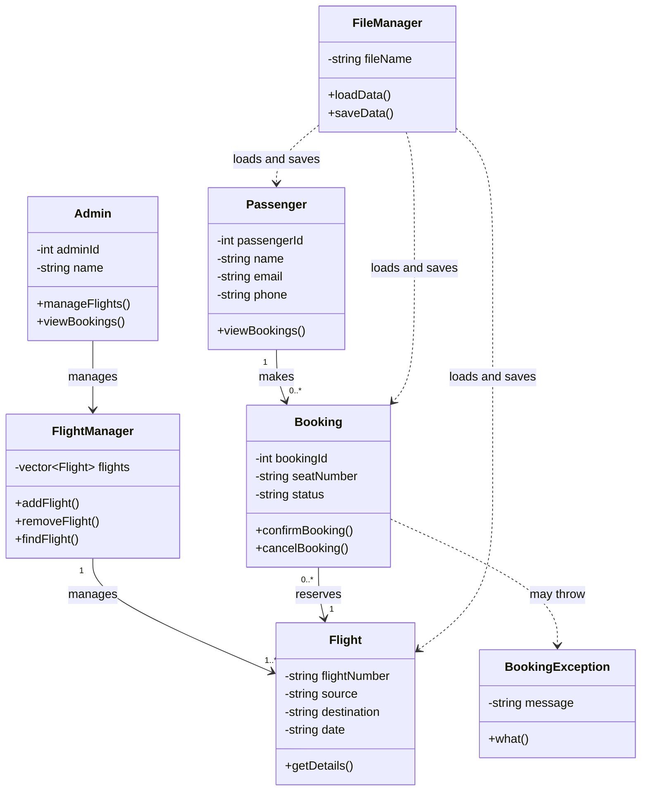

PROBLEM STATEMENT: 
Flight booking and seat map
The Flight Booking & Seat Map System allows users to view available seats, book seats, cancel bookings, and manage passenger information through a simple console-based interface.
VARSHA S: 251161
SINDHU S :251152
# ✈️ SkyBook – Flight Booking and Seat Map System

## 1. Project Overview

SkyBook is a flight booking and seat map management system.

The project demonstrates flight searching, seat selection, booking management, and flight information display.

The project uses C++ for core flight management logic, Node.js for the backend API, and React for the frontend interface.
SYSTEM ARCHITECTURE DIAGRAM

## UML Class Diagram




## 2. Technologies Used

- Frontend: React
- Backend API: Node.js
- Core application logic: C++
- API communication: HTTP and JSON
- Frontend deployment: Vercel
- Backend deployment: Render
- Source code management: GitHub

## 3. Project Links

**Live Website:**
https://flight-booking-seat-map-sy-git-2a9102-varshasrinivasan3010-2747.vercel.app/

**GitHub Repository:**
https://github.com/varsha-302007/flight-booking-seat-map-system

**Backend Health Check:**
https://skybook-api-agbx.onrender.com/api/test

**Flight API:**
https://skybook-api-agbx.onrender.com/api/flights

## 4. Project Structure

The repository contains the following main folders and files:

- `frontend/` – React frontend application.
- `api/` – Node.js API server.
- `src/` – C++ source files.
- `data/` – Text files used for flight, passenger, and booking data.
- `Documentation/` – Project documentation.
- `package.json` – Node.js project configuration.
- `package-lock.json` – Node.js dependency lock file.
- `README.md` – Project documentation and setup guide.

## 5. How the Application Works

1. The user opens the flight booking website.
2. The frontend allows the user to search for flights.
3. The frontend requests flight information from the Node.js backend.
4. The Node.js server executes the compiled C++ API program.
5. The C++ program returns flight information as JSON.
6. The frontend displays the available flight information and seat map.

## 6. Backend API Endpoints

### Check Backend Status

Method: `GET`

Endpoint:

`/api/test`

Expected response:

```json
{
  "success": true,
  "message": "Node API bridge is working!"
}
